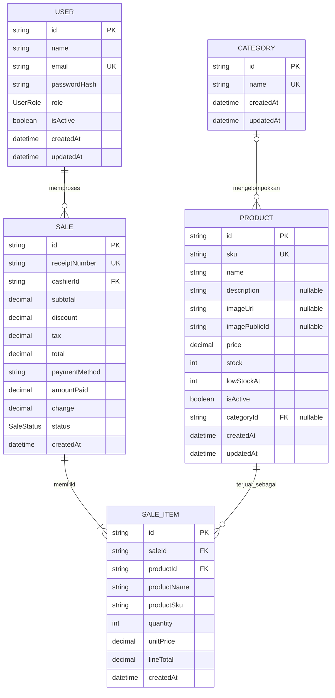

# ERD dan Database Kasa POS

ERD berikut menggambarkan model database MySQL yang digunakan aplikasi. Sumber skema yang menjadi acuan adalah `backend/prisma/schema.prisma`.

## Relasi

- **User–Sale (1:N):** satu user dapat memproses banyak transaksi; setiap transaksi memiliki tepat satu kasir melalui `Sale.cashierId`.
- **Category–Product (1:N, opsional di sisi Product):** kategori dapat memiliki banyak produk; produk boleh tidak memiliki kategori karena `Product.categoryId` nullable.
- **Sale–SaleItem (1:N):** satu transaksi memiliki item-item transaksi. Alur checkout mewajibkan setidaknya satu item.
- **Product–SaleItem (1:N):** satu produk dapat muncul pada banyak item transaksi; setiap item mengacu ke satu produk.
- Relasi konseptual **Sale–Product** adalah many-to-many dan dijembatani oleh `SaleItem`. Tabel penghubung ini menyimpan jumlah serta snapshot nama, SKU, dan harga saat transaksi.

## Kamus data ringkas

- `UserRole`: `ADMIN` atau `CASHIER`. Role baru yang didaftarkan selalu `CASHIER`.
- `SaleStatus`: `PAID` atau `VOIDED`.
- `Sale.paymentMethod`: metode pembayaran seperti `CASH`, `CARD`, atau `QRIS`; nilainya divalidasi pada API.
- Semua ID bertipe `String` dan dibuat menggunakan `cuid()`.
- `Product.price`, nominal pada `Sale`, dan `SaleItem.unitPrice`/`lineTotal` menggunakan `Decimal(12,2)`.
- `Product.description` dan `Product.categoryId` nullable; field selain itu mengikuti nullability pada schema Prisma.

## Aturan integritas dan perilaku

- `User.email`, `Category.name`, `Product.sku`, dan `Sale.receiptNumber` unik.
- Stok produk dan jumlah item adalah integer; API menolak nilai negatif untuk stok dan nilai jumlah yang bukan bilangan positif.
- Penghapusan kategori mengatur `Product.categoryId` menjadi `NULL` (`onDelete: SetNull`).
- Transaksi membatasi penghapusan user kasir dan produk yang sudah direferensikan (`onDelete: Restrict`).
- Penghapusan sale menghapus item-itemnya (`onDelete: Cascade`). Produk yang pernah terjual dinonaktifkan, bukan dihapus fisik.
- `SaleItem.productName`, `productSku`, dan `unitPrice` menyimpan snapshot agar detail historis tidak berubah ketika katalog diperbarui.
- Checkout memvalidasi ketersediaan produk dan pembayaran, lalu mengurangi stok serta membuat sale dan sale item dalam transaksi database dengan isolation level `Serializable`.

## Indeks

- `Product`: indeks pada `name` dan gabungan `categoryId, isActive`.
- `Sale`: indeks gabungan `createdAt, status` dan `cashierId, createdAt`.
- `SaleItem`: indeks pada `saleId` dan `productId`.

## Cara melihat diagram

File ini memakai Mermaid. Buka di editor atau platform yang mendukung Mermaid untuk melihat diagram; blok ERD juga dapat ditempel ke Mermaid Live Editor untuk diekspor sebagai gambar.
